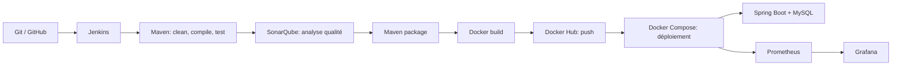

# Chaîne CI/CD DevOps : application de gestion de projets

Projet réalisé dans le cadre du module **DevOps** à ESPRIT. L'objectif n'est pas l'application métier, qui sert de support, mais la **mise en place d'une chaîne d'intégration et de livraison continues complète** : du commit Git jusqu'au déploiement conteneurisé et à la supervision.

L'application est composée d'un backend **Spring Boot** (API REST) et d'un frontend **Angular**.

## Architecture de la chaîne



## Étapes du pipeline Jenkins

Le `Jenkinsfile` à la racine définit les étapes suivantes :

| # | Étape | Rôle |
|---|-------|------|
| 1 | Checkout Git | Récupère le code depuis GitHub (identifiants Jenkins `github-cred`) |
| 2 | Maven Clean | Nettoie le projet |
| 3 | Maven Compile | Compile le backend |
| 4 | Maven Test | Exécute les tests unitaires |
| 5 | SonarQube Analysis | Analyse la qualité du code (token Jenkins `sonar-token`) |
| 6 | Maven Package | Génère le `.jar` |
| 7 | Docker Build | Construit l'image, taguée avec le numéro de build et `latest` |
| 8 | Docker Push | Publie l'image sur Docker Hub (identifiants `dockerhub-cred`) |
| 9 | Deploy (Docker Compose) | Redéploie la pile avec `docker compose down` puis `up -d` |

Bonnes pratiques appliquées :
- les secrets ne sont jamais écrits dans le dépôt : ils sont fournis par le **Credentials Store de Jenkins** (`withCredentials`) ;
- connexion Docker Hub avec `--password-stdin` ;
- rétention limitée des builds (`buildDiscarder`, 5 builds) ;
- nettoyage des images locales après chaque exécution (`docker rmi`, `docker image prune`).

## Stack technique

| Couche | Technologie |
|--------|-------------|
| Backend | Spring Boot, Spring Data JPA, Java 17, Maven |
| Frontend | Angular (composants standalone) |
| Base de données | MySQL 8.0 |
| CI/CD | Jenkins |
| Qualité de code | SonarQube |
| Conteneurisation | Docker, Docker Compose, Docker Hub |
| Supervision | Prometheus, Grafana |

## Structure du dépôt

```
.
├── backend/              # API REST Spring Boot (+ Dockerfile)
├── frontend/             # Application Angular
├── monitoring/
│   └── prometheus.yml    # Configuration de Prometheus
├── docker-compose.yml    # MySQL, Spring Boot, Prometheus, Grafana
├── Jenkinsfile           # Pipeline CI/CD
└── README.md
```

## Lancer la pile avec Docker Compose

Prérequis : Docker et Docker Compose.

```bash
git clone https://github.com/Nada1231/projet_Devops.git
cd projet_Devops
docker compose up -d
```

| Service | URL | Remarque |
|---------|-----|----------|
| API Spring Boot | http://localhost:8089 | exemple : `/entreprise/all` |
| Prometheus | http://localhost:9090 | |
| Grafana | http://localhost:3000 | identifiants par défaut `admin` / `admin` |
| MySQL | interne au réseau Docker | non exposé sur l'hôte |

Pour arrêter la pile : `docker compose down`.

## Lancer le projet sans Docker (développement)

**Backend** (Java 17, Maven 3.8+, MySQL 8 en local)

```bash
cd backend
mvn spring-boot:run
```

Le backend démarre sur http://localhost:8080. La base `test_db` est créée automatiquement ; adapter `application.properties` si besoin.

**Frontend** (Node.js 18+, Angular CLI)

```bash
cd frontend
npm install
ng serve -o
```

L'application s'ouvre sur http://localhost:4200.

## Configuration de Jenkins

Pour reproduire la chaîne :

- **Outils** (Manage Jenkins → Tools) : un JDK nommé `JAVA_HOME` et un Maven nommé `M2_HOME` ;
- **Credentials** : `github-cred` (accès Git), `sonar-token` (token SonarQube), `dockerhub-cred` (compte Docker Hub) ;
- **SonarQube** accessible sur `http://localhost:9000` depuis l'agent Jenkins ;
- **Docker** installé sur l'agent, avec l'utilisateur `jenkins` autorisé à l'utiliser.

## Application support

Gestion de projets pour une organisation composée d'entreprises, d'équipes et de projets.

| Entité | Description |
|--------|-------------|
| Entreprise | Nom et adresse, regroupe plusieurs équipes |
| Equipe | Appartient à une entreprise, a un nom et une spécialité, travaille sur plusieurs projets |
| Projet | Sujet de travail partagé entre plusieurs équipes |
| ProjetDetaille | Détails techniques : technologie, coût provisoire, date de début |

### Endpoints REST

| Ressource | Endpoints |
|-----------|-----------|
| `/entreprise` | `GET /all`, `GET /get/{id}`, `POST /add`, `PUT /update`, `DELETE /delete/{id}` |
| `/equipe` | mêmes opérations CRUD, plus `PUT /assign-entreprise/{equipeId}/{entrepriseId}` et `PUT /assign-projet/{equipeId}/{projetId}` |
| `/projet` | mêmes opérations CRUD |
| `/projet-detaille` | mêmes opérations CRUD, plus `PUT /assign-projet/{pdId}/{projetId}` |

## Limites et améliorations possibles

- Les mots de passe de la base et de Grafana sont des valeurs de démonstration : en production, les passer par des variables d'environnement ou des secrets Docker.
- Le frontend n'est pas encore conteneurisé dans le `docker-compose.yml`.
- Ajout possible d'un déploiement **Kubernetes** (manifests, probes, scaling) et de dashboards Grafana provisionnés automatiquement.
- Ajout possible d'un pipeline équivalent avec GitHub Actions.

## Auteure

**Nada Hsayri**, étudiante ingénieure à ESPRIT, Tunis.
[GitHub](https://github.com/Nada1231) · [LinkedIn](https://www.linkedin.com/in/nada-hsayri-7a73653a0/)
